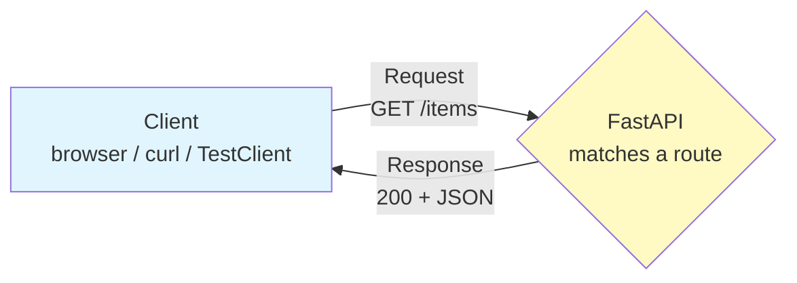
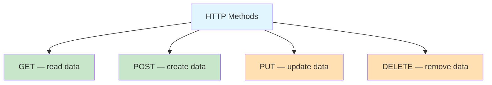
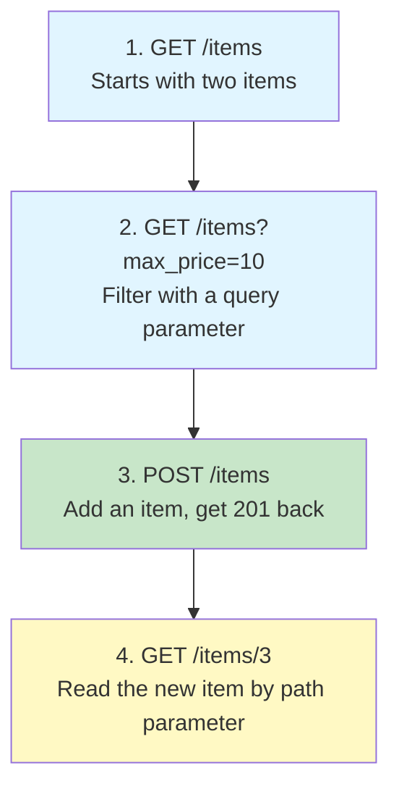

# Lab 0 — HTTP Basics for FastAPI

Difficulty: Beginner | ~20-25 min | No prerequisites

---

## 2. Problem Statement / Use Case Overview

Every API you will ever build speaks one language: **HTTP**. Before FastAPI, before Pydantic, there is a client sending an HTTP request and a server sending an HTTP response back. If that idea feels fuzzy, everything that follows feels like magic — routes, methods, status codes, JSON bodies.

This lab slows all the way down and builds that foundation. You will learn what HTTP is, where it is used, the request/response cycle, the four most common methods (`GET`, `POST`, `PUT`, `DELETE`), how query parameters and path parameters let a client point at exactly the data it wants, and what status codes mean. Then you will build two small FastAPI endpoints — one `GET` and one `POST` — and drive them with `TestClient` in the notebook, so you can watch the request go in and the response come back out.

That is the point. This is the ground floor the rest of the series stands on.

---

## 3. Input Data

An HTTP request is built from a few simple pieces. Each piece is one of the inputs our endpoints read:

*   **Method**: the verb that says *what* the client wants to do — `GET`, `POST`, `PUT`, or `DELETE`.
*   **URL / path**: *where* the request is aimed, e.g. `/items` or `/items/3`. FastAPI matches this against the routes you define.
*   **Path parameter**: a value baked into the path itself, like the `3` in `/items/3`.
*   **Query parameter**: an optional `?key=value` value appended to the URL, like `?max_price=10`. Good for filtering or search.
*   **Request body**: data the client *sends* to the server, usually JSON — and only certain methods (`POST`, `PUT`) carry one.
*   **Headers**: extra metadata (content type, auth tokens).

For our demo, a `POST /items` request looks like this:

```json
{
  "name": "Water Bottle",
  "price": 12.50
}
```

---

## 4. Processing

The request/response cycle executes the following sequence:

1.  **Client sends a request**: a browser, `curl`, or `TestClient` sends an HTTP request — method, URL, optional body.
2.  **Server receives it**: the ASGI server (like Uvicorn) hands the raw request to your FastAPI app.
3.  **Route matching**: FastAPI looks at the method and URL and finds the matching endpoint function. No match → `404`.
4.  **Parameter reading**: FastAPI reads any path parameter (`/items/{item_id}`) or query parameter (`?max_price=10`) out of the URL and passes it to your function.
5.  **Function runs**: your Python function executes and returns data (a `dict` or a `list`).
6.  **Response is sent**: FastAPI turns that return value into JSON, attaches a status code (default `200`, or `201` for a created item), and sends it back to the client.

---

## 5. Output

The service produces four distinct outputs based on the request:

1.  **Case 1 (GET the collection)**: `GET /items` → HTTP `200 OK` with a JSON array of every stored item.
2.  **Case 2 (GET with a query filter)**: `GET /items?max_price=10.0` → HTTP `200 OK` with only the items priced at or below 10.0.
3.  **Case 3 (POST a new item)**: `POST /items` with a JSON body → HTTP `201 Created` with the stored item, now including its assigned `id`.
4.  **Case 4 (GET one item)**: `GET /items/3` → HTTP `200 OK` with the single matching item.

---

## 6. Tech Stack

The lab uses the following dependencies:
*   `fastapi` — High-performance web framework for APIs.
*   `httpx` — HTTP client that powers FastAPI's `TestClient` inside the notebook.
*   *Note: No external API keys are required for this lab.*

---

## 7. Underlying Concepts

### What is HTTP?
HTTP (HyperText Transfer Protocol) is the standard set of rules that computers use to send data to each other over the web. It is a **request/response** protocol: a client asks for something, and a server answers. That is the entire idea. The client never reaches into the server's memory — it just sends a message and reads the reply.

### Where is HTTP used?
You use HTTP constantly, often without noticing:
*   Loading any web page in a browser.
*   A mobile app fetching its feed.
*   A frontend calling your backend to send a prompt.
*   `curl`, Postman, or `TestClient` hitting an API endpoint.
*   Two backend services talking to each other.

An **API** is simply a set of HTTP endpoints a server exposes so other programs can call them.

### The request/response cycle
Every interaction follows the same loop: a client sends a request, the server matches it to a route, runs the code, and sends a response back.



### HTTP methods
The method is the verb of the request — it tells the server *what* you want to do. FastAPI exposes each one through a matching decorator: `@app.get(...)`, `@app.post(...)`, `@app.put(...)`, `@app.delete(...)`.



| Method | Purpose | Sends a body? | Typical status |
|---|---|---|---|
| `GET` | Read data | No | `200 OK` |
| `POST` | Create a new item | Yes (JSON) | `201 Created` |
| `PUT` | Update/replace an item | Yes (JSON) | `200 OK` |
| `DELETE` | Remove an item | Usually no | `200 OK` / `204 No Content` |

This lab focuses on `GET` and `POST` — the two you will use most.

### GET vs. POST
The key difference is *intent* and *where data travels*:

*   **GET** is for reading. Any data it needs is put in the URL as a query parameter or path parameter. It carries **no body**. Because it changes nothing, a `GET` can be safely repeated — asking twice gives the same answer.
*   **POST** is for creating. It sends data in the **request body** as JSON. Because it changes server state, repeating it can create the item twice.

### Path parameters and query parameters
Both are ways to point at specific data through the URL — they just feel different:

*   **Path parameter** — part of the path itself, declared in the route with braces: `/items/{item_id}`. It usually *identifies* a specific resource. FastAPI reads it and converts it to the type you annotate (`item_id: int`).
*   **Query parameter** — the optional `?key=value` part after the path: `/items?max_price=10`. It usually *filters* or *options* a collection. FastAPI turns any function argument that is **not** in the path into a query parameter — give it a default (`max_price: Optional[float] = None`) to make it optional.

Read those annotations piece by piece:

*   `max_price: Optional[float] = None` — `max_price` is the parameter name, which becomes the `?max_price=` key; `Optional[float]` means the value is a number *or* nothing at all; and `= None` is the default that makes it optional, so a client may leave it out entirely.
*   `item_id: int` — `item_id` must match the `{item_id}` in the route path, and `: int` tells FastAPI to read that piece of the URL as an integer.

```python
@app.get("/items")                          # /items?max_price=10 -> query parameter
def list_items(max_price: Optional[float] = None):
    ...

@app.get("/items/{item_id}")                # /items/3 -> path parameter
def get_item(item_id: int):
    ...
```

### Status codes
A status code is the server's one-line summary of what happened. The first digit tells you the category:

*   **2xx — success**: `200 OK` (everything worked), `201 Created` (a new item was made).
*   **4xx — client error**: `404 Not Found` (no such resource), `422` (the request didn't fit the expected shape).
*   **5xx — server error**: `500 Internal Server Error` (something broke on the server).

### JSON
JSON (JavaScript Object Notation) is the common text format for request and response bodies — nested dictionaries and lists. It looks almost exactly like a Python `dict`/`list`, which is why FastAPI can convert between them automatically.

### What is FastAPI?
FastAPI is a Python **web framework** — a library that handles the HTTP plumbing for you. Instead of writing code to parse raw requests, match URLs, read JSON, and build responses, you write short Python functions and tell FastAPI which method and URL should call each one.

When a request arrives, FastAPI:
*   matches the method and URL to the right function (the route),
*   reads any path or query parameters and the request body,
*   runs your function,
*   converts whatever you return into JSON and sends it back with a status code.

It also generates an interactive documentation page for free at `/docs`, where you can try every endpoint straight from the browser.

That is the whole job: you write the functions, FastAPI does the HTTP.

### TestClient inside a Notebook
We use FastAPI's `TestClient` to send requests directly to our app inside the Jupyter notebook. It uses HTTPX under the hood to invoke FastAPI's routing system without spinning up a live server on localhost. Note: TestClient is used here as an interactive scratchpad tool for learning. It is stand-in for browser/ real client. You will learn about it in later labs. 

Here is the flow our two endpoints will demonstrate:



---

## 8. Prerequisites

*   None — this is the very first lab in the series. Basic Python (dictionaries, lists, functions) is assumed.

---

## 9. Environment / Dependencies Setup

To run this lab locally, perform the following commands in your shell:

```bash
# Create a fresh virtual environment
python -m venv venv

# Activate the virtual environment (Windows)
.\venv\Scripts\activate

# Install the dependencies
pip install fastapi httpx
```

---

## 10. Step-wise Development Instructions

### Cell 1: Dependency Installation
Installs FastAPI and httpx.
```python
!pip install fastapi==0.112.2 httpx==0.28.1
```

### Cell 2: Imports
Load the necessary modules. We use `Optional` for an optional query parameter, `Body` so FastAPI reads the request body, and `TestClient` to send requests from inside the notebook.
```python
# Import helpers for optional values, the app, the body, and the test client.
from typing import Optional
from fastapi import FastAPI, Body
from fastapi.testclient import TestClient
```

### Cell 3: In-Memory Store
We keep a simple Python list as our "database". Each item is a plain dictionary — no Pydantic yet.
```python
# A plain in-memory store. Restarting the kernel resets it.
items = [
    {"id": 1, "name": "Notebook", "price": 4.99},
    {"id": 2, "name": "Backpack", "price": 39.99},
]
```

### Cell 4: GET Endpoint with a Query Parameter
We initialize the app and define a `GET` route that returns the whole list. `max_price` is *not* in the path, so FastAPI treats it as an optional **query parameter** (`/items?max_price=10`). Its default of `None` means the filter is skipped when the client does not send it.
```python
# Create the app and a GET route that can filter by query parameter.
app = FastAPI()

# max_price : Optional[float] = None
#   max_price         -> parameter name; becomes the "?max_price=" query key
#   : Optional[float] -> the value is a number (float) or nothing (None)
#   = None            -> a default, so the client may leave it out entirely
@app.get("/items")
def list_items(max_price: Optional[float] = None):
    if max_price is None:
        return items
    return [item for item in items if item["price"] <= max_price]
```

### Cell 5: GET Endpoint with a Path Parameter
This route reads a single item. `{item_id}` is a **path parameter** — FastAPI takes it from the URL and converts it to an `int` because of the type hint. It returns the item whose `id` matches.
```python
# A GET route that reads one item by its path parameter.
# item_id : int
#   item_id -> parameter name; must match the {item_id} in the route path
#   : int   -> FastAPI reads that part of the URL as an integer
@app.get("/items/{item_id}")
def get_item(item_id: int):
    for item in items:
        if item["id"] == item_id:
            return item
```

### Cell 6: POST Endpoint with a Request Body
This route **creates** an item. The `item: dict = Body(...)` argument tells FastAPI to read the JSON body the client sends and pass it in as a dictionary. We assign the next `id`, store it, and return it. `status_code=201` sets the created status.
```python
# A POST route that reads a JSON body, stores it, and returns it.
# item : dict = Body(...)
#   item        -> parameter name
#   : dict      -> the body arrives as a Python dictionary
#   = Body(...) -> tells FastAPI to read this from the JSON request body
@app.post("/items", status_code=201)
def create_item(item: dict = Body(...)):
    next_id = max(existing["id"] for existing in items) + 1
    item["id"] = next_id
    items.append(item)
    return item
```

### Cell 7: Instantiate TestClient
Create a client wrapper to send requests to the app from inside the notebook.
```python
# Instantiating TestClient to run local API requests.
client = TestClient(app)
```

### Cell 8: Case 1 - GET the Collection
Reads every item.
```python
# Case 1: Read the whole collection (expecting 200 OK).
response_1 = client.get("/items")
print("Status Code:", response_1.status_code)
print("Response JSON:", response_1.json())
```

### Cell 9: Case 2 - GET with a Query Parameter
Appends `?max_price=10.0` to the URL so only cheaper items come back.
```python
# Case 2: Filter with a query parameter (expecting 200 OK).
# The query parameter is written straight into the URL after the "?".
response_2 = client.get("/items?max_price=10.0")
print("Status Code:", response_2.status_code)
print("Response JSON:", response_2.json())

# The same request can also be written with params={...} instead of the "?" string.
response_2b = client.get("/items", params={"max_price": 10.0})
print("Response JSON:", response_2b.json())
```

### Cell 10: Case 3 - POST a New Item
Sends a JSON body to create a new item.
```python
# Case 3: Create an item by sending a JSON body (expecting 201 Created).
new_item = {"name": "Water Bottle", "price": 12.50}
response_3 = client.post("/items", json=new_item)
print("Status Code:", response_3.status_code)
print("Response JSON:", response_3.json())
```

### Cell 11: Case 4 - GET the New Item by Path Parameter
Reads back the item we just created, now that it has an assigned `id`.
```python
# Case 4: Read the new item back by path parameter (expecting 200 OK).
response_4 = client.get("/items/3")
print("Status Code:", response_4.status_code)
print("Response JSON:", response_4.json())
```

---

## 11. What We Learnt

*   What HTTP is, where it is used, and why it is a request/response protocol
*   What FastAPI is, and how it handles the HTTP work behind each route
*   How a client request is matched to a FastAPI route and answered with a response
*   The four common methods — `GET`, `POST`, `PUT`, `DELETE` — and what each is for
*   Why `GET` reads (URL data, no body) and `POST` creates (JSON body)
*   How path parameters (`/items/{item_id}`) identify a resource and query parameters (`?max_price=10`) filter one
*   How status codes summarise the outcome (`200`, `201`, `404`, `422`, `500`)
*   How to call a FastAPI app directly in a notebook using `TestClient`, without running a server
